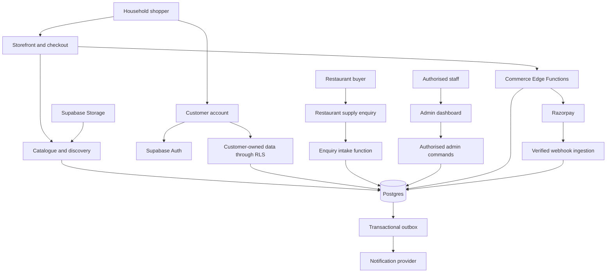
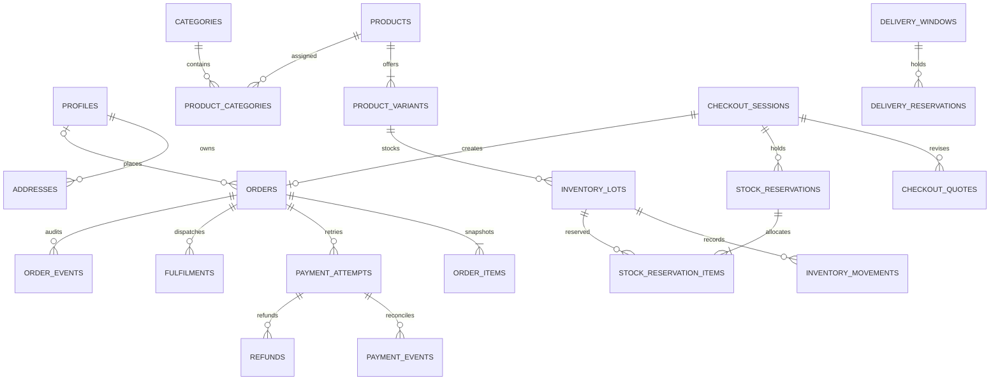
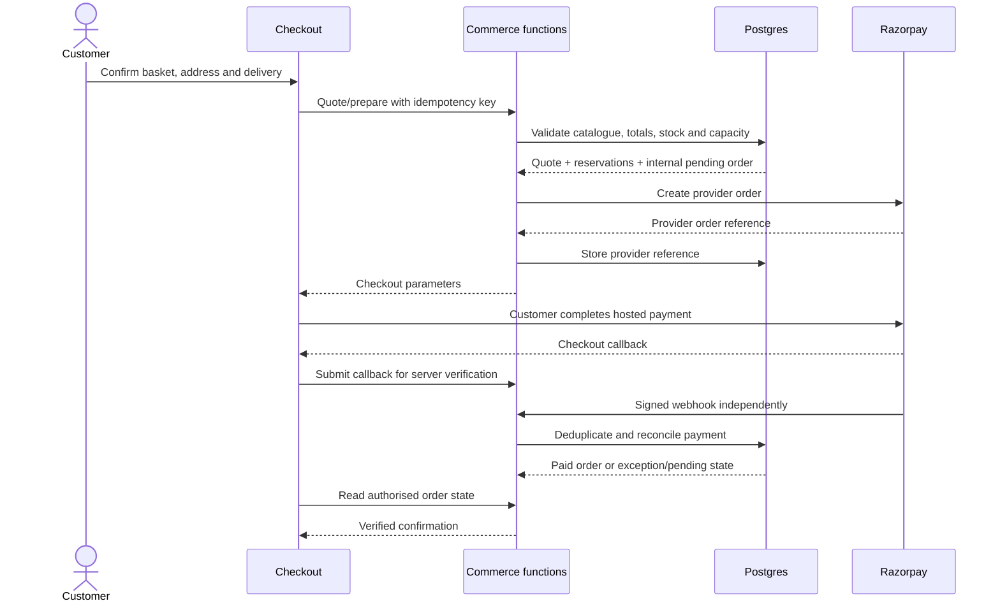

# WeGroween website system architecture

Version 0.3 | 10 October 2026 | Foundation implemented; remaining development proposed

Decision owner: user. Scope: 21 customer page types and 15 admin page types, using the existing WeGroween design language. Phase 1 now has runnable build tooling, a manifest-derived router, five shared layouts, token-based primitives and public HTML generation. The pages are foundation previews/scaffolds; database, authentication, payment and production integrations remain unimplemented. See `FOUNDATION_HANDOFF.md` for actual commands, files, verification and limitations.

## 1. Product boundary and decisions

WeGroween is a household-first fresh-produce store with a secondary restaurant-supply enquiry path. The storefront, customer account and operations dashboard use one catalogue, one inventory source and one order ledger. WhatsApp is a support channel. Online checkout is the primary purchase path.

The initial offer can cover microgreens, mushrooms, vegetables, fruits and combos. Category availability depends on confirmed launch products; categories are data rather than independent implementations. Combo products need explicit constituent-stock handling before they can be sold.

The architecture now covers 36 page types. The original 37-type baseline retired C04 on 10 October 2026: search is a shared expanding header interaction, and /search is a compatibility entry to Shop that restores the query. Product, category, customer and order records reuse their respective templates. Modals, filter panels, payment states, verification links, 404 and access-denied responses are additional states or utility handlers, not additional scoped page types.

| Decision | Architecture position | Status |
|---|---|---|
| Store and administration | One repository, shared domain modules, separate storefront and admin shells | Proposed |
| Visual language | Cultivated Editorial; Soil & Saffron primary; Fraunces + DM Sans; current tokens and imagery rules | Existing selections retained; design package remains 1.3.0-proposed |
| Frontend | Semantic HTML, compiled Tailwind, modular JavaScript; Vite build tooling and a manifest-derived route layer | Phase-1 scaffold implemented |
| Backend | Supabase Postgres, Auth, Storage and trusted Edge Functions | From approved brief; implementation not provisioned |
| Payments | Razorpay Standard Checkout with server-side reconciliation | From approved brief; merchant configuration pending |
| Guest checkout | Model supports optional accounts; launch behaviour awaits user answer | Open |
| Restaurant buying | Enquiry and staff-managed business account records; household checkout remains the purchase route | Proposed; business-specific pricing/credit ordering deferred |
| Delivery | Service-area validation and selectable eligible delivery dates/windows | Structure proposed; real rules unconfirmed |
| Notifications | Transactional outbox with a replaceable delivery provider | Proposed; email/SMS provider unselected |
| Hosting | CDN-hosted frontend plus Supabase services | Provider and preview/production setup unselected |

A new brand exercise is unnecessary for this architecture. Existing design release/archive decisions remain separate from application architecture. This work does not change the canonical design tokens or assert that prototype photographs are cleared for public use.

## 2. System map



Public catalogue reads and customer-owned data can use narrowly granted database APIs. Price calculation, inventory, order creation, payment handling and privileged admin commands run through trusted functions. Database transactions enforce consistency. Browser state improves interaction; it is never the authority for price, paid status or stock.

## 3. Navigation and page hierarchy

Storefront header: Shop, Our Farm, Restaurant Supply, Help, Search, Account and Cart. Shop exposes the available launch categories. Check delivery availability early without blocking browsing. Mobile navigation contains the same destinations and accessible menu controls.

Footer: help/contact, delivery policy, returns/refunds, privacy, terms and verified business/contact details. The checkout shell is quieter: identity, progress, support and order summary.

Account navigation: Overview/profile, Orders, Addresses and Sign out. Sign out is an action. Admin navigation: Overview, Orders, Products, Categories, Inventory, Customers, Restaurant Supply, Promotions, Delivery, Reports and Settings. Permissions determine visibility and actual server access.

```text
Storefront
  Home
  Shop
    Category -> Product
    Search -> Product
  Our Farm
  Restaurant Supply
  Help / Contact / FAQs
  Cart -> Checkout -> Order confirmation
  Identity: Sign in / Register / Recover password
  Account
    Profile
    Addresses
    Orders -> Order detail / tracking
  Policies: Delivery / Returns / Privacy / Terms

Administration
  Sign in -> Overview
  Orders -> Order detail
  Products -> Product editor
  Categories
  Inventory
  Customers -> Customer detail
  Restaurant enquiries / accounts
  Promotions
  Delivery settings
  Reports
  General settings
```

### Customer pages: 21 reusable types

| ID | Page and route | Main sections and primary action | Data and access |
|---|---|---|---|
| C01 | Home `/` | Approved H1 homepage structure, seasonal products, category discovery, provenance, delivery clarity, restaurant pathway. Shop this harvest. | Public published content and catalogue. |
| C02 | Shop `/shop` | Intro, available categories, filters, sorting, paginated product grid. Open product or add selected pack. | Public catalogue; URL-backed filters. |
| C03 | Category `/shop/category/:slug` | Category introduction, category-specific filters, product grid. Explore a product. | One template for all published categories, including combos if launched. |
| C05 | Product `/products/:slug` | Gallery, verified description, pack/variant, price, availability, delivery eligibility, storage/use guidance, provenance and related products. Add to cart. | Published product, variants and safe availability projection. |
| C06 | Our Farm `/our-farm` | Brand story, real practices, verified provenance and photographs. Explore products. | Curated content; evidence-backed claims. |
| C07 | Restaurant Supply `/restaurant-supply` | Supply capabilities, available categories, enquiry process and business form. Send enquiry. | Public content; rate-limited enquiry intake. |
| C08 | Help `/help` | FAQs, order/delivery help, verified contact details, contact form and WhatsApp link. Get support. | Public FAQs; intake function stores support enquiries. |
| C09 | Cart `/cart` | Line items, pack/quantity controls, availability warnings and indicative totals. Continue to checkout. | Local cart; signed-in cart sync; server revalidation before purchase. |
| C10 | Checkout `/checkout` | Contact, identity option, address, eligible delivery window, promotion, substitution consent if offered, final quote and Razorpay payment. Pay. | Trusted quote/reservation functions; customer or protected guest session. |
| C11 | Confirmation `/orders/:orderId/confirmation` | Verified payment/order state, reference, delivery summary and next steps. View order. | Owner or protected guest access; pending payment is a real state. |
| C12 | Sign in `/sign-in` | Credentials, recovery link and safe return destination. Sign in. | Supabase Auth; redirect back to allowed internal route. |
| C13 | Register `/register` | Minimal identity fields, consent and verification state. Create account. | Supabase Auth; no client-selected staff role. |
| C14 | Password recovery `/recover-password` | Request link, invalid/expired link handling and set-new-password mode. Recover access. | One page type with secure Auth recovery callback handling. |
| C15 | Profile `/account` | Profile/contact data, recent-order shortcut and preferences. Save permitted changes. | Customer-owned profile; verified changes where required. |
| C16 | Addresses `/account/addresses` | Address list, add/edit form, default marker and eligibility feedback. Save address. | Customer-owned addresses. |
| C17 | Order history `/account/orders` | Paginated orders, dates, amount, payment/fulfilment state and repeat-order action. Open order. | Customer-owned orders; reorders revalidate current catalogue. |
| C18 | Order detail `/account/orders/:orderId` | Item and price snapshots, delivery tracking timeline, payment/refund state, support and policy-eligible cancellation request. Track or get help. | Customer ownership; guest access via protected order session if enabled. |
| C19 | Delivery policy `/policies/delivery` | Service areas, charges, timing, cutoff and failed-delivery terms. Check coverage. | Versioned, approved policy content. |
| C20 | Returns/refunds `/policies/returns` | Perishable-goods issue reporting, cancellation windows and refund process. Get help. | Approved policy; rules remain unconfirmed. |
| C21 | Privacy `/policies/privacy` | Actual data handling, providers, retention and contact channel. | Approved legal content reflecting implemented operations. |
| C22 | Terms `/policies/terms` | Business identity and purchasing/service conditions. | Approved legal content. |

### Admin pages: 15 reusable types

| ID | Page and route | Main sections and primary action | Permission and data |
|---|---|---|---|
| A01 | Sign in `/admin/sign-in` | Staff sign-in and MFA challenge/recovery states. Enter dashboard. | Auth identity plus server-verified active staff membership. |
| A02 | Overview `/admin` | Orders requiring action, delivery queue, low stock and payment/refund exceptions. Open actionable work. | Aggregated data constrained by staff permissions. |
| A03 | Orders `/admin/orders` | Filters, order list, status, delivery date and pagination. Open order. | `orders.read`. |
| A04 | Order detail `/admin/orders/:orderId` | Immutable purchased items, payment events, reservation/fulfilment state, timeline, internal notes and authorised cancellation/refund actions. Advance order. | `orders.manage`; separate `refunds.manage` for refunds. |
| A05 | Products `/admin/products` | Search, draft/published state, category and availability. Create or edit product. | `catalogue.read/manage`. |
| A06 | Product editor `/admin/products/new` and `/admin/products/:productId/edit` | Identity, slug, variants/packs, media, category membership, description, handling, provenance, SEO and preview. Save draft/publish. | One page type with create/edit modes; `catalogue.manage`. |
| A07 | Categories `/admin/categories` | Ordered category list and inline/drawer editor. Maintain categories. | `catalogue.manage`; no product-specific duplicated pages. |
| A08 | Inventory `/admin/inventory` | Lots, saleable stock, reservations, low stock, expiry and reasoned adjustments. Record stock change. | `inventory.manage`; append-only movement ledger. |
| A09 | Customers `/admin/customers` | Search, recent orders and business/customer classification. Open customer. | `customers.read`, restricted personal-data access. |
| A10 | Customer detail `/admin/customers/:customerId` | Profile, orders, support context and linked business account. Review customer history. | Permission-gated; passwords and payment credentials never shown. |
| A11 | Restaurant Supply `/admin/restaurant-supply` | Enquiry queue, inline detail, qualification, assigned staff and business-account tabs. Respond internally/mark qualified. | `restaurant.manage`; sending outbound messages requires implemented channel and authorised operation. |
| A12 | Promotions `/admin/promotions` | Active/scheduled codes, inline editor, conditions, usage and expiry. Publish promotion. | `promotions.manage`; server evaluates eligibility. |
| A13 | Delivery `/admin/delivery` | Service areas, charges, cutoff rules, blackout dates, slot capacity and inline editors. Update delivery rules. | `delivery.manage`; protect committed order snapshots. |
| A14 | Reports `/admin/reports` | Defined-period orders, captured payments, refunds, fulfilment and stock movements; CSV export. Review operations. | `reports.read`; financial detail restricted. |
| A15 | Settings `/admin/settings` | Business details, notification preferences/templates, policy versions and staff-permission controls. Save authorised configuration. | `settings.manage`; role assignment limited to owner. Secrets configured outside the browser. |

Utility routes: `/auth/callback` and a guest order-access handler if enabled. These validate credentials, then redirect to an existing page. Unknown paths produce a proper 404. Admin access failure produces 403/access-denied state. Expired sessions return users to sign-in while preserving an allowed internal destination.

## 4. Frontend layout and composition

| Shell | Used by | Shared structure |
|---|---|---|
| Storefront | Discovery, brand, supply, help and policies | Header, category navigation, main content, delivery notice and footer. |
| Checkout | Cart, checkout and confirmation | Compact header, step context, support link and responsive order summary. |
| Identity | Customer and staff authentication | Minimal form layout, inline errors and verification/recovery state. Staff identity remains visually distinct. |
| Account | Profile, addresses and orders | Storefront identity, account navigation, content and mobile navigation equivalent. |
| Admin | Authenticated staff pages | Side navigation, top bar, breadcrumbs, permission-aware content and operational notifications. |

Components are shared at the lowest useful level. A customer product card and admin table are different patterns, built from common buttons, fields, badges, typography and tokens. The dashboard keeps the brand but uses operational density, legible tables and clear actions.

| Component family | Components | Required states/contracts |
|---|---|---|
| Foundation | Button/link, input, select, checkbox, radio, textarea, label, form error, heading, divider, icon | Accessible name, focus, disabled reason, busy state; no colour-only communication. |
| Navigation | Header, mobile menu, breadcrumbs, footer, account navigation, admin navigation, pagination | Current destination, keyboard operation, focus restoration, URL-preserved pagination. |
| Discovery | Product card, product grid, category tile, filter panel, sorting, search box | Loading, empty, failure, sold out, seasonal unavailability; no stale stock promise. |
| Product | Gallery, variant selector, quantity control, price display, availability, provenance, delivery checker | Accessible image alternatives, selected pack, valid quantity, pack-specific price. |
| Commerce | Cart line, totals, address form, delivery selector, promotion field, payment action, order summary | Requoting, price change acknowledgement, stock conflict, reservation expiry and payment pending/failure. |
| Customer | Profile form, address editor, order card, timeline, reorder action | Validation, expired session, ownership failure and discontinued items on reorder. |
| Operations | Data table, filters, editor form, status transition panel, adjustment form, exception banner, export control | Pagination, permission failure, empty result, concurrency conflict and traceable change reason. |
| Feedback | Inline message, alert, dialog, toast, skeleton and empty state | Important results persist inline; transient toasts are supplementary. Dialog focus is contained and restored. |

Every page has default, loading, empty where relevant, error, unauthorised where relevant and responsive states. Availability and checkout require explicit pending states. Existing design token values remain the source of truth; generated token CSS is consumed rather than manually rewritten. Primary production palette is Soil & Saffron; comparison palettes do not become a public theme switch.

## 5. Domain modules and state ownership

| Module | Owns | Consumed by |
|---|---|---|
| Catalogue | Published products, variants, category membership, pack specifications, media metadata and search | Storefront, cart validation and admin catalogue. |
| Identity and access | Auth session, customer profile, staff membership and permissions | Account, checkout, admin and protected APIs. |
| Cart | Product/variant IDs, quantities, local persistence and signed-in cart sync | Header, product page, cart and checkout. |
| Pricing | Current sale prices, promotion conditions, tax calculation and delivery charge | Server quote, order snapshots and reports. |
| Inventory | Lots, stock movements, reservations, saleable quantities and allocation | Availability, checkout, fulfilment and admin inventory. |
| Delivery | Service eligibility, fees, delivery windows, cutoff/capacity and blackout rules | Product/cart estimates, checkout and fulfilment. |
| Orders | Order snapshots, allowed state transitions, fulfilment events and cancellation requests | Customer orders, admin orders and reports. |
| Payments | Provider orders, attempts, capture confirmation, webhook reconciliation and refund records | Checkout, confirmation, admin exceptions and reports. |
| Restaurant supply | Enquiries, qualification, staff assignment and business-account links | Public form and admin supply workspace. |
| Support and content | FAQs, incoming support, farm story and versioned policies | Public content, help and admin settings. |
| Notifications and audit | Durable delivery requests, retries and privileged action records | Commerce, customer support and admin. |

URL owns discovery query, category, filters, sort and pagination. Forms own unsaved drafts. The database owns business truth. Cart persistence contains identifiers and quantities, not trusted prices or personally identifiable checkout fields. An authenticated cart merge combines matching variants according to a documented quantity rule and then revalidates availability.

### Rendering and SEO

Use a frontend route registry and shared templates instead of 36 copied HTML files. Vite compiles assets; it does not by itself supply public-page server rendering or a database-backed prerender pipeline. Public home, category, product, farm, help, supply and policy pages must produce meaningful HTML and route-specific metadata before launch. A build-time catalogue snapshot can generate those pages while stock and checkout refresh from live services.

Publishing a product/content change queues a controlled rebuild of generated public HTML. A failed rebuild keeps the previous release live, exposes its status to staff and permits retry. Stock changes never require a full rebuild. If the required publishing cadence makes rebuilds unsuitable, choose a server-rendered HTML framework/hosting adapter before frontend scaffolding; this document does not silently assume one.

Product/category sitemap entries come from published records. Search/filter duplicates use deliberate canonical/indexation rules. Account, checkout and admin routes are private/non-indexed. Old `microgreens.html`, `mushrooms.html` and `combos.html` URLs redirect to their matching category destinations when those categories launch. Retired products retain an informative page where useful or return a deliberate 404/410; do not redirect every missing product to Home.

## 6. Data model

All money is stored as integer minor units with currency, not floating-point totals. Pack size and stock units are explicit. Timestamps are stored consistently in UTC; customer delivery dates/cutoffs use Asia/Kolkata. IDs are stable; public slugs are unique and changes retain redirects. Staff permissions and payment fields are never customer-editable.

| Domain | Entities and important fields |
|---|---|
| Identity | Supabase `auth.users`; `profiles` (user_id, name, verified contact references, preferences); `addresses` (owner, address, postal code, eligibility reference); `staff_memberships` and `staff_permissions` (active membership and authoritative permissions). |
| Catalogue | `categories` (slug, title, position, publication state); `products` (slug, title, description, status, provenance/handling, SEO); `product_categories`; `product_variants` (SKU, pack quantity/unit, price_minor, currency, sale status, inventory unit conversion); `product_media` (storage key, alt text, ordering, rights status). |
| Combos | `bundle_components` (bundle variant, constituent variant, quantity required). Availability is constrained by all constituents; nested bundles/cycles are rejected at launch. |
| Stock | `inventory_lots` (variant, received/harvest date, expiry, location, disposition); `inventory_movements` (lot, quantity delta, reason, linked order/adjustment, actor); `stock_reservations` (checkout/order, expiry, state); `stock_reservation_items` (lot/component allocation and quantity). |
| Cart and checkout | `carts`, `cart_items`; `checkout_sessions` (owner or hashed guest-session reference, expiry, idempotency key); `checkout_quotes` (version, source prices, totals, delivery decision, valid_until); `checkout_quote_items`; `delivery_reservations`. |
| Orders | `orders` (owner nullable only for enabled guest flow, reference, checkout link, contact/address snapshots, quote version, delivery snapshot, totals, independent payment/fulfilment states, policy/consent references); `order_items` (SKU/title/pack/tax/price snapshots); `order_events` (actor, transition, reason); `fulfilments` and `fulfilment_items` (delivery/dispatch event and lot allocation). |
| Payments | `payment_attempts` (order, unique provider order/payment IDs, expected amount/currency, status); `payment_events` (unique provider event ID, verified event metadata and reconciliation result); `refunds` (order/payment, unique operation key, amount, reason and provider state). |
| Delivery | `delivery_zones`, `delivery_rules`, `delivery_windows` (eligible date/slot, capacity and cutoff), `delivery_reservations` (checkout/order, quantity, expiry, state). The initial capacity unit must be confirmed. |
| Promotions | `promotions` (code, period, eligible variants/categories, minimum, limits, discount rule); `promotion_redemptions` (order/customer or guest reference, pending/committed/released). |
| Restaurant | `restaurant_enquiries` (business/contact, interest, expected demand, status, assignee); `business_accounts` (company, linked customer, qualification state, staff notes). Contract pricing and credit ledger are deferred. |
| Support/content | `support_enquiries` (contact, message, optional authorised order link, status); `content_entries` (key, version, structured body, publication state); `policy_versions` (policy type, effective version, approved content). |
| Operations | `notification_outbox` (event key, destination, template, attempts, next retry, delivered state); `audit_log` (actor, action, entity, changed fields, reason); `settings` (allowlisted non-secret configuration). |

`auth.users` remains managed by Auth. Passwords never enter project tables. Public product projections exclude supplier cost and internal notes. Raw financial/stock tables are private; the exposed API schema only grants access to deliberate projections and permitted owner operations.



### Database invariants

- A SKU, product/category slug, provider payment ID, provider event ID and command idempotency key have appropriate unique constraints.
- Available stock is saleable unexpired stock minus active holds and committed, not-yet-consumed allocations, with conditional updates/locking in a database transaction. Batch allocations follow earliest usable expiry where applicable. Virtual combos reserve constituent lots rather than a second copy of bundle stock.
- Reservation, stock and delivery-capacity changes occur atomically with the internal checkout/order transition. External provider calls use durable operation records and reconciliation because they cannot join the database transaction.
- An order's purchased items, amount, delivery address and policy version are snapshots. Editing a product, address or fee later cannot rewrite an existing order.
- Every privileged stock adjustment has a reason and audit record. Spoiled/returned perishable goods do not automatically become saleable stock.
- Promotion use limits reserve capacity for pending checkout and commit or release it once; browser calls cannot bypass them.
- Refund totals cannot exceed eligible captured amounts. Payment retries may create new attempts, never duplicate the purchased order or fulfilment. A second captured attempt for the same order enters a duplicate-payment exception/refund workflow rather than creating another fulfilment.
- Version checks reject conflicting staff edits instead of silently overwriting changes. Foreign keys and intentional archive rules preserve order/audit history.

## 7. Checkout, payment and fulfilment workflow



1. The basket holds variant IDs and requested quantities. Entering checkout refreshes price, stock and delivery eligibility. The customer acknowledges material price/availability changes before paying.
2. The quote function derives line prices, discounts, tax and delivery from stored rules, then returns a versioned, expiring quote. Client totals are ignored. Tax applicability/rates and displayed tax treatment remain business inputs.
3. Prepare checkout creates an internal pending order and reserves exact stock, delivery capacity and promotion capacity in one database transaction. A stable operation key makes repeated submissions return the same result.
4. A trusted function creates the Razorpay order for the expected amount/currency. Provider timeout or network ambiguity is reconciled against the durable operation record; do not blindly issue a second provider order.
5. The callback undergoes server signature verification against the stored provider order ID. A signed callback is not the sole reason to mark an order paid: reconcile captured amount, currency, provider references and authoritative provider state. If capture is delayed, display payment processing.
6. Webhooks verify the signature using the raw request body and webhook secret, record unique event IDs, and pass through the same reconciliation logic. Callback/webhook duplicates and out-of-order events cannot downgrade or double-apply completed state.
7. Confirmed capture converts reservations to committed allocations once and queues order notification through the outbox. Staff then confirm, prepare and dispatch the order. Reservation expiry must never release committed stock.
8. Failed/cancelled attempts preserve the basket. Before reservation expiry/release, reconcile uncertain payments. A late captured payment after a reservation has been released enters an exception queue: reallocate atomically if possible; otherwise hold fulfilment and apply the approved refund/support procedure. Never promise unavailable produce.
9. Eligible cancellation releases unfulfilled allocations and queues the appropriate payment/refund operation. A refund request stays pending until provider confirmation. Refunding money does not imply returned produce is saleable.
10. Reorder copies purchasable variant IDs and desired quantities into a fresh basket, then uses today's availability and prices. Historical discounts are not reused automatically.

### Independent states

| State machine | States and rules |
|---|---|
| Payment | `pending -> authorised -> captured`; failed attempts may be retried; captured funds may become partially/refunded through refund records. Captured never becomes failed because a late failed-attempt event arrives. |
| Fulfilment | `unconfirmed -> confirmed -> preparing -> dispatched -> delivered`; controlled branches include cancellation before dispatch, failed delivery and manual exception. Allowed transitions are permission-checked. |
| Stock reservation | `active -> committed` or `active -> released/expired`; `committed -> consumed` at dispatch or `committed -> released` on eligible cancellation. Ledger stock consumption and reservation consumption are atomic; release/expiry/consumption apply once. |
| Refund | `requested -> processing -> succeeded/failed`; retries use the same logical operation key until reconciled. Customer display distinguishes requested from completed. |
| Restaurant enquiry | `new -> contacted -> qualified -> account_created` or `closed`; this does not automatically grant staff or business credit privileges. |

The product is not a delivery fleet management system. Order tracking initially uses staff-maintained status and optional verified tracking references. Live driver location, route optimisation and automatic substitutions are outside this baseline.

## 8. Guest and account access

If guest checkout is enabled, contact and shipping snapshots can belong to an order without a registered user. The server issues a high-entropy, short-lived checkout/order session, stores a hash and uses a secure HttpOnly same-site cookie on a same-site API origin or a supported equivalent deployment. The API resolves order access from that session, not a supplied email or order ID alone. Raw secrets stay out of local storage and analytics. Guest API reads return only the authorised order.

A returning guest receives a short-lived, single-use access link via the selected transactional channel, exchanged for an order session; consuming that link removes its secret from the URL before analytics. Revocation, expiry, rate limits and link-delivery behaviour require acceptance checks. If the hosting arrangement cannot support this safely, guest checkout is not shipped by assumption.

Optional account creation after purchase is separate from payment. Link an existing guest order to an account only after verified control of the purchase contact/session. Matching an entered email is insufficient. If sign-in is required for launch, use Auth ownership throughout and leave guest order creation disabled server-side; the same page count is retained.

## 9. API and command boundaries

Names below are contracts for planned functions, not provisioned endpoints. Every command validates schema, identity/guest session, permission, ownership, allowed state and concurrency. Business failures use stable codes and actionable messages; provider internals are not leaked.

| Contract | Caller/input | Responsibility/output |
|---|---|---|
| Catalogue read/search | Public; query, filters, pagination | Safe published product/variant projections, bounded result sets and availability hint. |
| `delivery-eligibility` | Shopper; address/postal code and cart quantities | Supported area, eligible windows and indicative fee; validate again during quote. |
| `checkout-quote` | Owner/protected guest session; variant quantities and delivery choice | Server-derived quote, validity and change/conflict messages. |
| `checkout-prepare` | Owner/protected guest session; quote ID/version and idempotency key | Atomic reservation/order preparation and reconciled provider checkout reference. |
| `payment-verify` | Order owner/session; callback fields | Signature verification and provider reconciliation; confirmed or pending order state. |
| `payment-webhook` | Provider; raw signed payload | Signature validation, durable event deduplication and shared reconciliation. No user JWT expected. |
| `order-read` | Owner/protected guest session; order reference | Authorised order snapshot and customer-visible timeline only. |
| `order-cancel-request` | Owner/protected guest; reason and operation key | Validate policy/state, record request and apply permitted automated steps. |
| `restaurant-enquiry` | Public; business/contact/request | Validate, rate-limit, record enquiry and queue acknowledgement. |
| `support-enquiry` | Public/owner; message and optional order link | Validate intake; verify ownership before linking protected order details. |
| `admin-order-transition` | Permitted staff; order/version/action/reason | Enforce state machine, stock/capacity consequences and audit trail. |
| `admin-refund` | Refund-permitted staff; payment/amount/reason/key | Record durable refund operation and reconcile provider outcome. |
| `admin-catalogue-command` | Catalogue staff; validated product/category/variant change | Maintain records, restrict publication and queue public-page rebuild. |
| `admin-inventory-adjust` | Inventory staff; lot/quantity/reason/version | Atomic ledger movement, stock checks and audit record. |
| `admin-settings-command` | Owner/permitted staff; allowlisted setting/version | Versioned changes; owner-only role grants and no client payment-secret changes. |
| `admin-report-export` | Report-permitted staff; period/filter | Permission-filtered export; escape spreadsheet formula-like values. |
| `maintenance-reconcile` | Trusted scheduler only | Reconcile uncertain payments/refunds, expire safe holds, retry outbox and flag exceptions. |

Typical errors: `QUOTE_EXPIRED`, `PRICE_CHANGED`, `OUT_OF_STOCK`, `DELIVERY_UNAVAILABLE`, `PAYMENT_PENDING`, `RESERVATION_EXPIRED`, `CONFLICT`, `UNAUTHORISED` and `FORBIDDEN`. Do not infer successful payment from a success-page URL or let a client set order totals/status.

## 10. Permissions and security

| Actor | Allowed operations |
|---|---|
| Visitor | Published content/catalogue reads, delivery checks, protected guest checkout if enabled, rate-limited enquiries. |
| Customer | Own profile/addresses/cart/orders, purchases, policy-eligible cancellation requests and verified guest-order claiming. |
| Operations staff | Permission-scoped orders, fulfilment and customer context; no automatic refund, role or settings privilege. |
| Catalogue staff | Product/category/media management and separately granted inventory access. |
| Owner/admin | Explicitly granted financial reports, refunds, settings and staff-permission management. |
| System worker | Narrow trusted webhook, reconciliation and notification duties; inaccessible as public admin commands. |

RLS and explicit grants protect exposed tables and owner reads. Trusted role membership lives outside customer-editable profile metadata. A hidden admin link is not access control. Client-facing publishable keys do not grant privileged access; service-role and payment secrets remain in trusted runtime secret configuration. These boundaries follow [Supabase RLS guidance](https://supabase.com/docs/guides/database/postgres/row-level-security) and [Supabase data-security guidance](https://supabase.com/docs/guides/database/secure-data).

Payment integration follows [Razorpay Standard Checkout integration](https://razorpay.com/docs/payments/payment-gateway/web-integration/standard/integration-steps/) and [webhook validation guidance](https://razorpay.com/docs/webhooks/validate-test/). The shared payment reducer handles replay and reordered delivery. Webhook ingress can omit user authentication only because provider-signature verification is mandatory.

Architecture controls also include server-side input validation, least-privilege storage policies, staff MFA, rate limits on identity/enquiry/checkout entry points, strict CORS for the deployed origin, anti-CSRF checks for cookie-authenticated commands, safe internal redirects, escaped/sanitised content and redacted logs. Uploads validate actual media type/size and store generated file names; public product photos and private customer documents use separate access rules. A receipt is not called a tax invoice until the actual tax/business requirements are established.

Audit logs record privileged changes and reasons without storing secrets or full payment payloads unnecessarily. Data retention, erasure handling, marketing consent and legal policy wording require actual business decisions. This architecture supplies data/version fields, not invented legal compliance claims.

## 11. Repository structure

This is the intended complete development structure. Its phase-1 app, layout, component, page, style, script and test foundation is now implemented; feature/service/backend directories remain future work. Work stays in the verified moved checkout `E:\WeGroween\WeGroween`. The original homepage is preserved in `legacy/pre-foundation/index.html`; the other legacy category sources and the current `design-system/` and `design-memory/` retain their provenance.

```text
WeGroween/
  docs/
    SYSTEM_ARCHITECTURE.md        # this canonical explanation
    PAGE_MANIFEST.json            # 36 types and route/access/render contracts
  design-system/                  # current canonical design-language package
  design-memory/                  # existing project design history
  src/
    app/
      routes.js                   # application registry derived from manifest
      bootstrap.js
      navigation.js
      session.js
    layouts/
      storefront.js
      checkout.js
      identity.js
      account.js
      admin.js
    pages/
      storefront/                 # home/shop/category/search/product/content
      commerce/                   # cart/checkout/confirmation
      identity/                   # sign-in/register/recovery
      account/                    # profile/addresses/orders/order detail
      admin/                      # 15 page types, including sign-in
    components/
      primitives/
      navigation/
      catalogue/
      commerce/
      account/
      admin/
      feedback/
    features/
      catalogue/
      identity/
      cart/
      checkout/
      orders/
      restaurant-supply/
      support/
      administration/
    services/
      supabase-client.js          # public configuration + caller session
      api-client.js              # typed/validated command boundary
      media.js
    state/
      cart.js
      ui.js                      # ephemeral interaction state only
    styles/
      app.css                    # imports generated token CSS + compiled utilities
    content/                     # reviewed source content, no secret records
  public/
    fonts/
    brand/
    placeholders/                # explicitly labelled until cleared assets exist
  scripts/
    generate-public-pages.js     # planned prerender/content-publish pipeline
    validate-page-manifest.js
  supabase/
    migrations/                 # versioned tables, constraints, grants and RLS
    seed.sql                    # synthetic local data, no live customer data
    functions/
      _shared/                  # validation, identity, permission, payment adapters
      checkout-quote/
      checkout-prepare/
      payment-verify/
      payment-webhook/
      order-read/
      admin-commands/
      enquiry-intake/
      maintenance-reconcile/
    tests/                      # database invariants and access-control cases
  tests/
    unit/                       # pricing/state reducer/cart rules
    integration/                # commerce, permissions and provider contract cases
    e2e/                        # customer and staff journeys
  .env.example                  # variable names and safe placeholders only
  package.json                  # pinned dependencies once scaffolded
  vite.config.js                # route/build configuration once scaffolded
```

Shared domain calculations belong on the server or in tested pure modules, not copied into pages. Database transaction functions own atomic reservations. Payment-provider interaction stays behind an adapter. Do not create a separate service for every page. Build tooling recommendations are supported by [Vite production-build documentation](https://vite.dev/guide/build.html) and [Tailwind's Vite integration](https://tailwindcss.com/docs/installation/using-vite); exact versions are selected and pinned during scaffolding.

## 12. Content and operations readiness

| Input | Needed for | Publication rule |
|---|---|---|
| Launch products, SKUs, packs, real prices, stock units and tax treatment | Product pages, pricing, inventory and checkout | Draft data can support local development; clearly synthetic data cannot become live offers. |
| Product photos, brand assets and public-use permission | Storefront and metadata | Prototype permission does not imply public licensing. |
| Farm/provenance statements and organic/certification evidence | Home, farm and product copy | Publish only supported claims. |
| Delivery geography, postal codes, fees, minimum basket, cutoff, capacity and handling | Eligibility and fulfilment | Configure and verify real service constraints before accepting orders. |
| Perishable issue policy, cancellation and refund rules | Policies and order commands | Staff actions and customer copy must match implemented policy. |
| Business/legal contact details and approved policy wording | Footer, support, terms and receipts | Use actual reviewed details rather than guessed boilerplate. |
| Restaurant process and staff owner | Supply page and enquiry queue | First release handles enquiries; do not imply contract pricing or credit terms without agreement. |
| Merchant account, webhook secrets, notification provider and production host | Payment and communications | Separate test/production configuration; verify delivery and reconciliation before launch. |

## 13. Development order and exit criteria

| Stage | Pages/modules | Required result |
|---|---|---|
| 1. Foundation | Route registry, five shells, tokens, primitives, public-page rendering strategy | Reusable navigation/layouts work on mobile and keyboard; all 36 page types are mapped without duplicated business logic. |
| 2. Catalogue | C01-C08; catalogue, media, product/category/search | Realistic local data; public page HTML/metadata and working discovery; approved H1 structure preserved. |
| 3. Identity and accounts | C12-C18; Auth, profiles, addresses, owned orders | Customer A cannot read/write customer B's data; session expiry and recovery work. Guest decision incorporated. |
| 4. Commerce and policy | C09-C11, C19-C22; pricing, reservations, delivery and payments | Test-mode end-to-end purchase; duplicate callbacks/webhooks and stock races reconcile correctly. |
| 5. Admin foundation and catalogue | A01-A02, A05-A08, A15 | Staff permissions/MFA, publication workflow and traceable stock changes. |
| 6. Admin orders and business | A03-A04, A09-A14 | Fulfilment, customer lookup, enquiries, promotions, delivery, refunds and clearly defined reports. |
| 7. Launch readiness | All pages, real approved content, environment, monitoring and recovery | Business rules and rights confirmed, test suite and accessibility/performance checks passed, payment reconciliation and restore procedure verified. |

The first reviewable implementation is Home -> Shop/category -> Product -> Cart using local data and the approved visual language. This validates browsing, reusable layouts and cart behaviour before introducing live operations. Stage order is dependency-driven; shared database and command contracts are prepared alongside frontend work.

## 14. Acceptance checks

| Area | Meaningful acceptance cases |
|---|---|
| Scope | Exactly 21 customer and 15 admin page types; aliases/modes do not inflate count; page routes/access/render strategies resolve. |
| Discovery | Search/filter/sort/pagination state survives URL navigation; invalid slug returns 404; unpublished products do not leak. |
| Accounts | Own-data allow and other-user deny; verified recovery; roles cannot be edited through customer profile APIs. |
| Stock and delivery | Two customers race for last pack/slot; only eligible allocation succeeds; expired/spoiled lot cannot be sold; bundle components reserve atomically. |
| Pricing | Manipulated client price is ignored; expired quote reprices; discounts respect limits; currency/tax/rounding are deterministic. |
| Payments | Test success/failure/cancel; signature mismatch; amount mismatch; double click; duplicate/reordered webhook; callback before/after webhook; provider timeout and late capture. |
| Orders/refunds | Reorder uses current price; state-transition denial; cancellation releases appropriate holds once; refund retry/reconciliation; spoiled return remains unsaleable. |
| Staff | Direct API denial without permission; financial/refund/role restrictions; conflicting edits produce explicit conflict; audit reasons exist. |
| Accessibility | Keyboard navigation, focus/menu/dialog handling, labelled forms, announced errors, reduced motion, contrast and readable zoomed/mobile layouts. |
| Content and performance | Cleared media, accurate claims, optimized responsive images, stable layout, meaningful public HTML, correct canonical metadata and legacy redirects. |
| Operations | Outbox/provider retry, payment exception queue, logs without secrets, environment separation, rollback and database/object-storage restoration rehearsal. |

Phase-1 route/access checks, production build and browser foundation checks have run; results are recorded in `FOUNDATION_HANDOFF.md`. Catalogue, database, commerce, real permissions and payment acceptance tests remain future work and are not claimed by foundation checks.

## 15. Deployment and operating model

Development uses local/synthetic data and Razorpay test mode. Staging uses separate backend configuration, private previews and isolated payment/notification credentials. Production has distinct keys, public rights-cleared content and approved business rules. Client bundles contain only public configuration.

Deploy migrations with explicit review, then compatible functions/frontend releases. Build previews check route resolution and generated product/category HTML. Rebuild failures must not erase the last working storefront. Monitor payment reconciliation failures, ageing pending orders, negative-stock prevention alerts, notification backlog and failed privileged commands. Keep database backups and an independent object-storage recovery plan; prove restoration rather than assuming product photographs are included in a database backup.

Reports distinguish placed order value, captured payment value, successful refunds and delivered sales for a stated date basis. They are operating reports, not a substitute for a tax/accounting system. The server records UTC; customer/staff views use the configured business timezone and disclose date filters.

## 16. Decisions to resolve before dependent implementation

1. Guest checkout or mandatory sign-in. The existing 36 page types support either; the security/session implementation differs.
2. Launch catalogue: confirmed products, pack sizes, SKU/stock units, bundle contents, prices and tax handling.
3. Delivery geography, fees, cutoff dates, slots/capacity, substitutions and cancellation/refund policy.
4. Static public-page rebuild cadence versus server-rendered hosting. This determines the final frontend scaffold/adapter.
5. Production host, notification channel/provider and payment merchant setup.
6. Staff roles, order fulfilment responsibilities and restaurant-enquiry handling.
7. Public asset permissions, factual claims, business/legal details and design release status.

These inputs do not prevent architecture and synthetic-data development. They must be resolved before the dependent production behaviour is enabled. Wishlist, subscriptions, loyalty, reviews, a recipe/blog system, multi-vendor sales, business credit checkout, live delivery tracking and a mobile app require separately agreed scope.

## 17. Source basis

- Project `README.md`: existing catalogue originally directed shoppers to WhatsApp.
- `design-memory/projects/wegroween/brief/approved-brief.md`: household-first online commerce, secondary restaurant supply, required customer/admin surfaces and Supabase/Razorpay direction.
- `design-system/README.md`, `PROJECT_STATUS.md`, `BRAND_IDENTITY_BLUEPRINT.md` and canonical token/language inputs: current selected identity, H1/R3 preservation, proposed release status and unresolved operating inputs.
- Conversation on 5 October 2026: 22 customer and 15 admin page types proposed, followed by the user's request to design the entire system structure based on that scope.
- Primary technical documentation linked above, checked on 5 October 2026. Architecture-specific workflows and entity design are this project's proposed engineering decisions.
